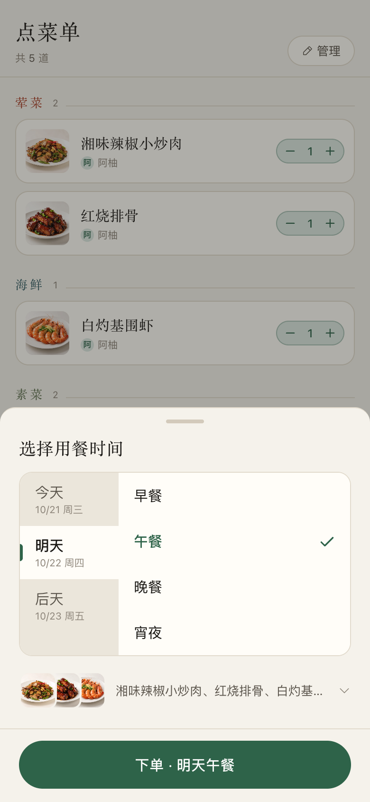
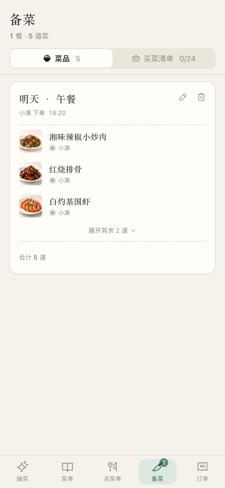
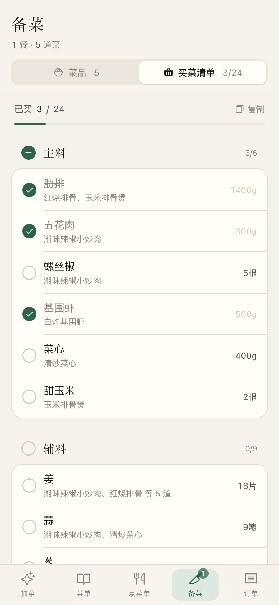
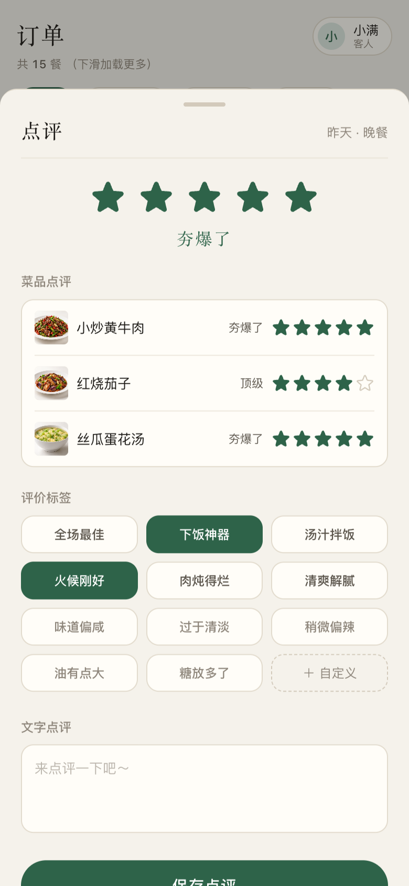
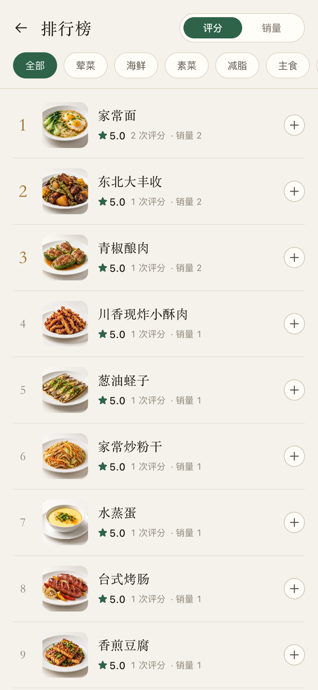
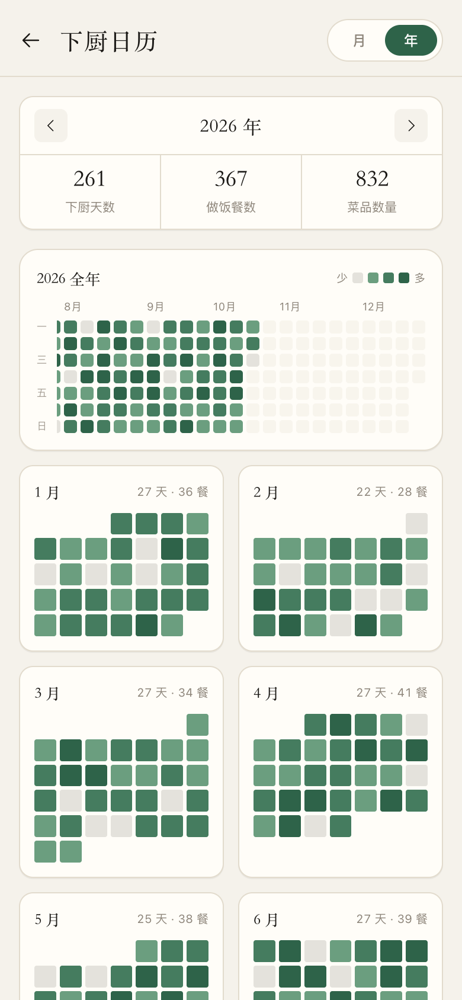
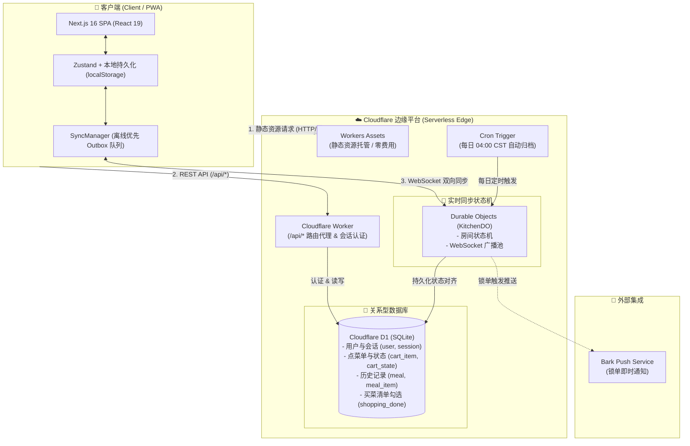

<div align="center">


# 慧厨时光 (Tidy Cookbook)

**简单好用的多人实时点菜软件**

抽菜灵感决策 · 多人实时点菜 · 多时段预订 · 买菜清单自动合并 · 锐评与下厨日历

[](https://nextjs.org/)
[](https://react.dev/)
[](https://workers.cloudflare.com/)
[](https://tailwindcss.com/)
[](./LICENSE)

[English](./README_EN.md) | **简体中文**

### 🌐 公测体验：[eat.ruiovo.com](https://eat.ruiovo.com)

手机浏览器打开即用，无需下载。公测期间所有人共用一份点菜单和历史记录，请勿填写真实个人信息，数据之后可能清空。

</div>

---

## 🎬 宣传片 (Demo Video)

<table>
  <tr>
    <td align="center" width="50%">
      <a href="https://www.bilibili.com/video/BV1kAnq6tE59/"></a>
      <br />
      <a href="https://www.bilibili.com/video/BV1kAnq6tE59/"><b>▶ 在 B 站观看完整宣传片（45 秒）</b></a>
      <br />
      <sub>也可以 <a href="./docs/media/promo.mp4">下载 mp4</a></sub>
    </td>
    <td align="center" width="50%">
      
      <br />
      <em>🔄 多人同步点菜 · 情侣点菜、亲朋好友来做客都好用</em>
    </td>
  </tr>
</table>

<p align="center">
  
  <br />
  <em>🎲 选择困难症了？又犯愁吃啥？来试试抽菜！</em>
</p>

---

## 📱 视觉预览 (Screenshots)

| 1. 抽菜灵感 | 2. 菜谱浏览 | 3. 做法详情 | 4. 多人点菜单 | 5. 预订时段 |
| :---: | :---: | :---: | :---: | :---: |
|  |  |  |  |  |
| 选择困难症了？来试试抽菜！ | 93 道家常菜，拼音速搜 | 大图、分级食材与关键步骤 | 情侣点菜、亲朋好友来做客都好用 | 24 小时守护你的胃 |

| 6. 备菜 | 7. 买菜清单 | 8. 锐评 | 9. 排行榜 | 10. 下厨日历 |
| :---: | :---: | :---: | :---: | :---: |
|  |  |  |  |  |
| 一键查看食材和做法，省心又省力 | 要买什么，一张清单全列好 | 哪道菜夯爆了？哪道菜拉完了？ | 老板来份招牌菜！ | 记录你的每一餐，成就感拉满！ |


---

## 💡 为什么做这个项目 (Why Tidy Cookbook)

市面上的主流美食与菜谱类 App 充斥着卖课买课、电商带货、冗长短视频与商业广告。做饭本来是一件纯粹、治愈的日常琐事，不应被算法和推荐流绑架。

**慧厨时光**最早是为了解决我和女朋友每天「晚上吃什么、做什么菜」的纠结，只专注每天做饭决策的几个核心步骤：

1. **今天吃什么？** —— 拿不定主意时，按荤/素/海鲜/轻食等分类随心抽一道，不合心意左右滑换一道，抽中直接加入点菜单。
2. **快速挑菜** —— 收录精选家常菜，支持**菜名 / 全拼 / 首字母 / 食材**极速拼音搜索（如输入 `xcr` 秒出小炒肉）。
3. **点这一餐** —— 全家人或情侣可以通过各自手机协同点菜，增减份数、左滑删除，全端状态毫秒级实时同步；下单时可以选今天、明天、后天的早餐 / 午餐 / 晚餐 / 宵夜，提前预订。
4. **智能买菜清单** —— 自动将整餐所有菜品的食材提取并按同名食材智能合并累加，按份数倍乘（如：`五花肉 300g`、`姜 4片`），买菜时打勾状态全员实时同步，还可一键复制文本发送到微信。备菜时点开任意一道菜即可查看完整做法。
5. **吃完记一笔** —— 从「拉完了」到「夯爆了」滑动打分、贴标签，单菜评分汇总成排行榜；下厨日历按月 / 年热力图记录每一餐。

---

## ✨ 核心特性 (Key Features)

- 🎲 **抽菜灵感**：卡片式触感翻动，支持荤、海鲜、素菜、减脂轻食、主食单向筛选，内置最近历史去重算法，避免连续抽中重复菜品。
- 📖 **双联交互菜单**：左侧竖向分类导航栏，支持点击瞬间直达与滚动联动监听；图片采用动态优先级调度器（Priority Scheduler），大跨度跳转不浪费带宽。
- ⚡ **原生级 SPA 视口保活（Keep-Alive）**：底栏 Tab 切换采用单页多视图保活架构，消灭传统路由反复销毁与 DOM 重建带来的卡顿，内存保留每个 Tab 独立的滚动位置，切换响应速度 `< 16ms`。
- 🔄 **全端实时协同（Real-time Sync）**：基于 Cloudflare Durable Objects 与 WebSocket，支持点菜单与买菜清单勾选状态的全员实时双向广播。
- 📦 **离线优先设计（Offline-First）**：无网状态下依然可加菜、勾选清单；网络恢复后自动进行 Outbox 队列回放与快照对齐。
- 🛒 **智能食材合并**：独创跨菜品食材解析合并引擎，同名同单位食材自动数值倍乘累加，支持调料一键折叠展开。
- 🗓️ **多时段预订**：下单时选择就餐日期（今天 / 明天 / 后天）与餐别（早餐 / 午餐 / 晚餐 / 宵夜），同一餐重复下单自动合并。
- ⭐ **锐评与排行榜**：五档评级「拉完了 / NPC / 人上人 / 顶级 / 夯爆了」滑动选择，支持单菜评分与评价标签；首页排行榜按评分和点单次数排序，可直接加单。
- 🔥 **下厨日历**：订单页内置热力图，月视图记录每天做了几道菜、平均几分，年视图一屏看完全年下厨记录。
- 📋 **小票账单式历史**：支持按 `全部`、`近 7 天`、`近 1 个月`、`近 3 个月` 筛选；向下滚动自动流式分页懒加载；支持每日凌晨 4:00 自动定时归档并重置点菜单。
- 🎨 **纸墨极简设计系统**：严格遵守自定义调色板（`paper`、`ink`、`chili`、`brine`、`leaf`、`caramel`），移动端安全区深度适配，内嵌物理震动触感（Haptic Feedback）。

---

## 🛠️ 技术架构 (Tech Stack)



- **前端架构**：Next.js 16 (App Router) + React 19 + TypeScript + Zustand。采用 `output: "export"` 纯静态导出，由 Workers Assets 提供边缘零成本托管。
- **持久化存储**：Cloudflare D1（基于 SQLite 的边缘分布式数据库）。
- **实时同步**：Cloudflare Durable Objects（启用 Hibernation API，休眠时不消耗计费时长；平台层自应答 Ping/Pong 心跳）。
- **会话持久化**：支持 Cookie 与 `localStorage` 令牌双重容灾，免登状态缓存 90 天，配合服务端自动滑动续期。
- **通知机制**：锁单确认后通过 Bark API 实时推送订单摘要至手机设备。

---

## 🔒 数据安全与备份机制 (Data Safety & Backups)

项目的数据安全与灾备策略经过深度考量，完全托管于 Cloudflare 边缘分布式基础设施中：

1. **官方原生每日自动快照（Automated Backups）**：
   - Cloudflare D1 数据库每日自动执行系统级快照备份（PITR），官方自动保留最近 **30 天** 的历史备份点；
   - 如遇误删或异常，可登录 Cloudflare 控制台 -> **D1 SQL Database** -> `tidy-cookbook` -> **Backups** 选项卡直接一键回滚还原。
2. **全量本地离线备份导出（Manual Dump）**：
   - 随时可以通过 Wrangler 命令将线上真实数据库导出为标准的本地 `.sql` 备份副本：
     ```bash
     pnpm exec wrangler d1 export tidy-cookbook --remote --output=./backup_$(date +%Y%m%d).sql
     ```
3. **零敏感信息入库**：
   - 账号密码采用 `PBKDF2-SHA256` 进行 **100,000 轮** 强化哈希计算，每人配备专属独立随机盐值，明文密码永不出设备；
   - 所有 Cloudflare 凭证与推送秘钥（如 `BARK_URL`）均通过 Cloudflare Worker Secret 或 GitHub Actions Encrypted Secrets 安全注入，Git 提交历史 100% 干净无泄露。

---

## 🚀 快速上手 (Quick Start)

### 1. 环境准备
本项目采用 `pnpm` 作为包管理器，要求 Node.js >= 18：

```bash
git clone https://github.com/RUIIIOVO/tidy-cookbook.git
cd tidy-cookbook
pnpm install
```

### 2. 本地开发

```bash
pnpm dev
```
浏览器打开 `http://localhost:3000` 即可开始预览。

### 3. 构建与检查命令

```bash
pnpm build            # 优化配图 + 重建清单 + 编译静态站点 (产出 ./out)
pnpm lint             # ESLint 语法与规范检查
pnpm cf:typecheck     # Cloudflare Worker 后端代码类型检查
pnpm preview          # 在本地 Miniflare / Workers 完整运行时环境中模拟运行
```

---

## 🌐 私有化部署指南 (Cloudflare Deployment)

本项目专为 Cloudflare 免费配额优化设计，全套基础设施可在免费额度内终身免费运行。

### 步骤一：配置 Wrangler

复制配置文件模版：
```bash
cp wrangler.example.jsonc wrangler.jsonc
```

登录 Cloudflare 账号：
```bash
pnpm exec wrangler login
```

### 步骤二：初始化 D1 数据库

1. 创建 D1 数据库：
   ```bash
   pnpm exec wrangler d1 create tidy-cookbook
   ```
   记录命令输出的 `database_id`，将其填入 `wrangler.jsonc` 对应字段。

2. 执行数据表初始化迁移：
   ```bash
   pnpm exec wrangler d1 execute tidy-cookbook --remote --file=./schema.sql
   pnpm exec wrangler d1 migrations apply tidy-cookbook --remote
   ```

3. 生成初始管理员账号（owner 权限）：
   ```bash
   node scripts/seed-users.mjs 你的用户名:你的密码:owner > /tmp/seed.sql
   pnpm exec wrangler d1 execute tidy-cookbook --remote --file=/tmp/seed.sql && rm /tmp/seed.sql
   ```

### 步骤三：绑定 Bark 通知推送密钥（可选）

如需在锁单时接收 Bark 推送通知：
```bash
pnpm exec wrangler secret put BARK_URL
# 输入形如：https://api.day.app/YOUR_KEY/
```

### 步骤四：一键部署

```bash
pnpm build
pnpm deploy
```

### 可选：独立的试用环境

`wrangler.jsonc` 里预置了 `eat` 环境（独立 Worker、D1、Durable Object，数据与正式环境完全隔离），设置了 `TRIAL=1` 后所有注册用户按 owner 权限处理，适合公开给别人体验：

```bash
pnpm exec wrangler d1 create tidy-cookbook-eat          # 把 database_id 填进 env.eat
pnpm exec wrangler d1 execute tidy-cookbook-eat --remote --env eat --file=./schema.sql
pnpm build && pnpm exec wrangler deploy --env eat
```

> **关于大陆访问优化**：Cloudflare 默认的 `*.workers.dev` 域名在部分地区可能存在 SNI 阻断。建议在 Cloudflare 仪表盘绑定自己的自定义域名（如 `cook.yourdomain.com`），享受国内高速直连。

---

## 🍳 增改菜谱规范 (Custom Dishes)

项目中所有菜谱均以紧凑编码集中收录于 `src/data/raw.ts`。

### 编码格式规范：
```ts
[94, "菜品名称", "一句话口感描述（吃起来什么样，禁止口号）", "小类分类", 辣度(0-3), ["标签1", "标签2"],
  "主|主料 份量@辅|辅料 份量@调|调料 份量",
  "第一步做法@第二步做法@第三步做法@第四步做法"],
```

- **菜品 ID**：每行开头的手写递增正整数，一经使用**永不修改、不复用、不重排**（数据库历史订单与配图文件名均绑定此编号）。
- **更新索引**：每当修改或添加菜品后，只需执行：
  ```bash
  node scripts/build-pinyin.mjs
  ```
  脚本会自动重新生成无字典依赖的拼音首字母索引。
- **自动配图管线**：在 `scripts/dish_prompts.json` 中添加英文提示词，运行：
  ```bash
  python3 scripts/gen-dish-images.py --ids 94
  ./scripts/optimize-images.sh
  node scripts/build-image-manifest.mjs
  ```
  自动生成统一质感的餐盘摄影级配图并优化为 800px WebP 格式。

---

## 📄 开源许可证 (License)

本项目基于 [MIT License](./LICENSE) 协议开源。
