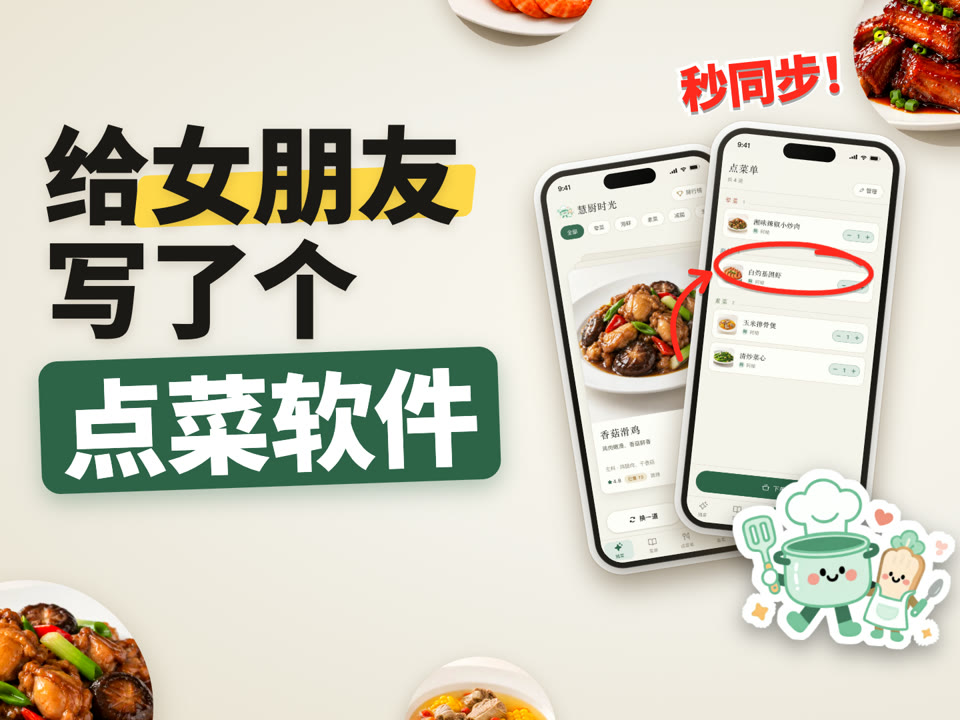
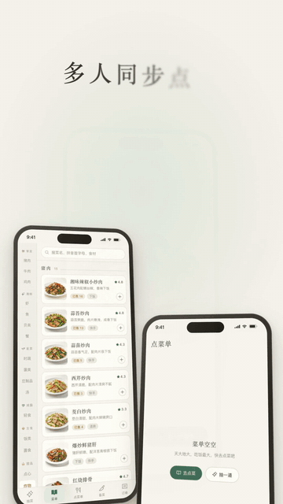
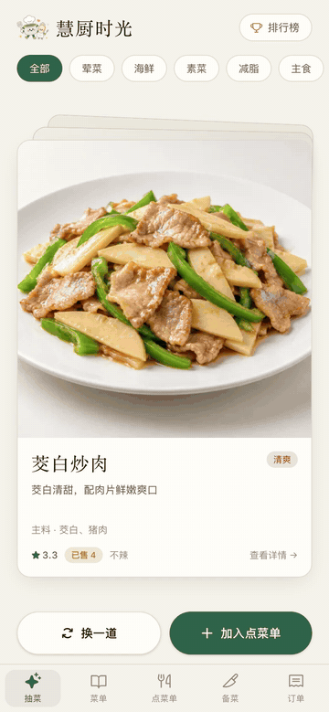
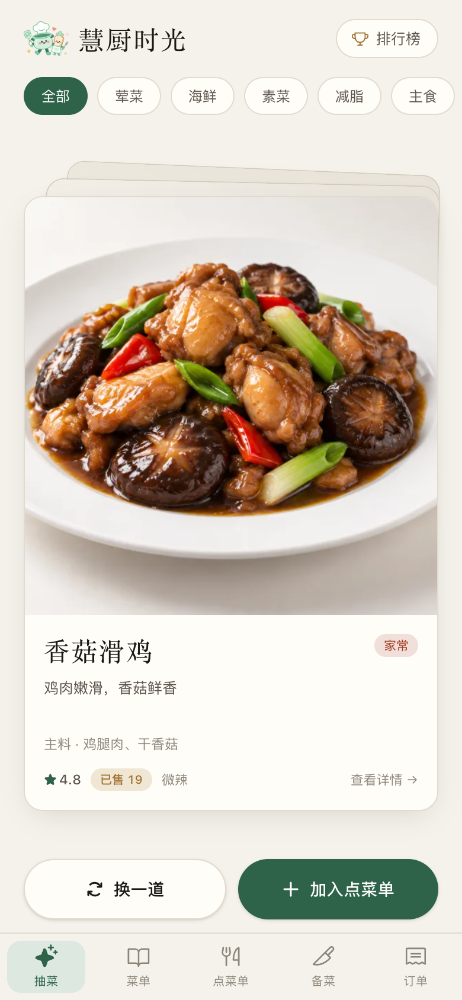
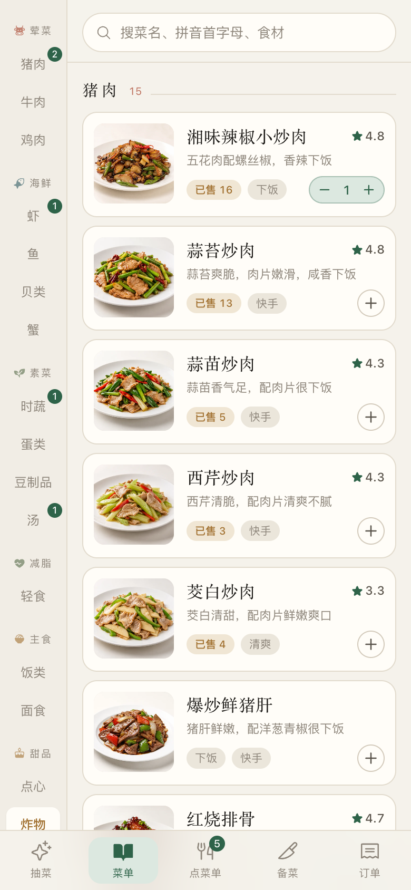
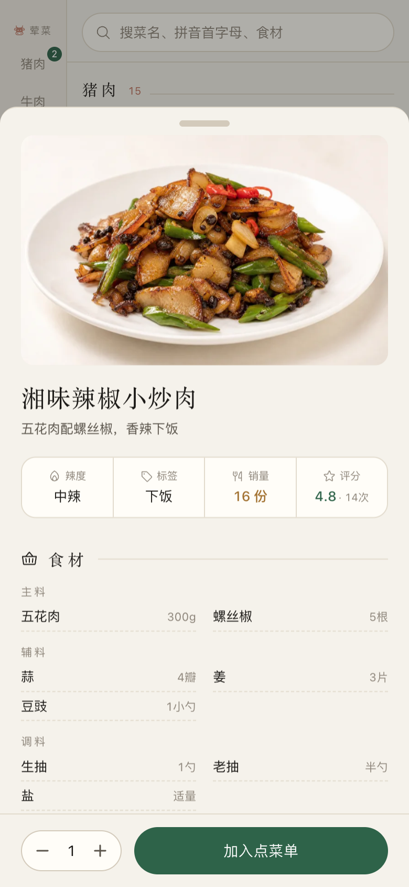
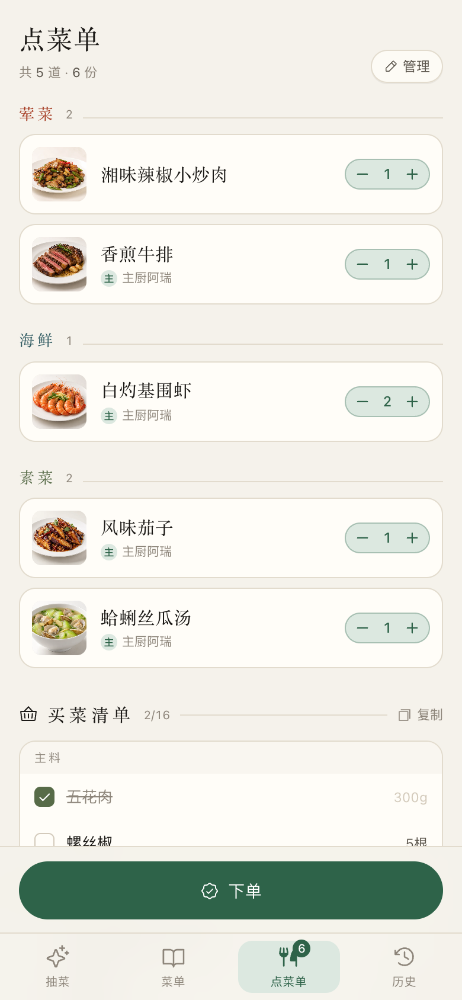
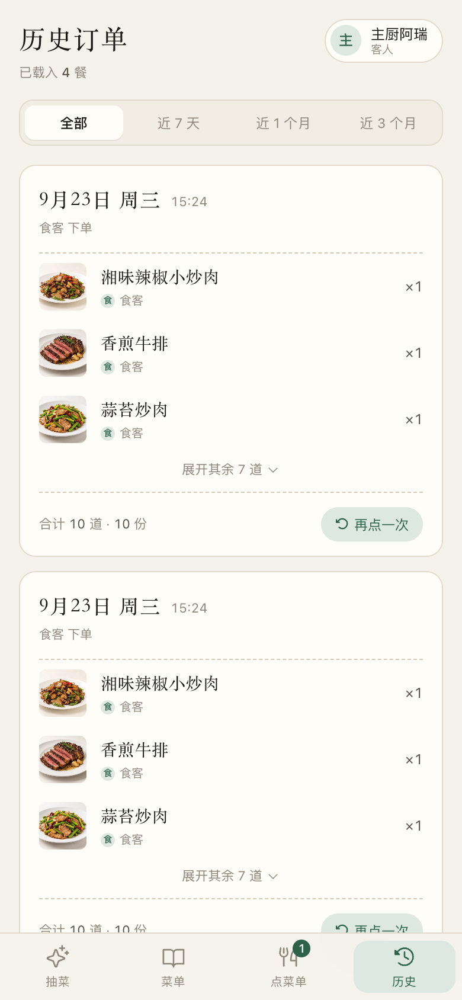
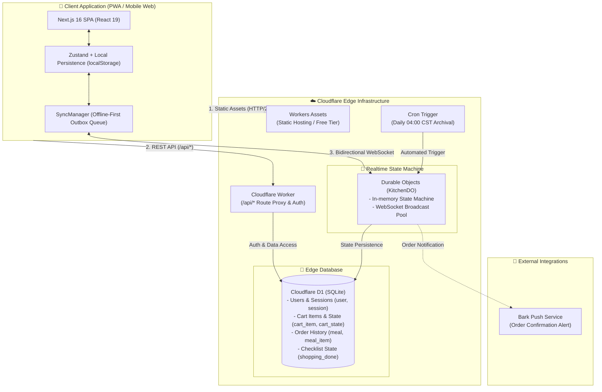

<div align="center">


# 慧厨时光 · Tidy Cookbook

**A simple, real-time meal ordering app for the whole household.**

Tactile dish picking · Real-time shared ordering · Meal pre-ordering · Auto-merged grocery lists · Ratings & cooking calendar

[](https://nextjs.org/)
[](https://react.dev/)
[](https://workers.cloudflare.com/)
[](https://tailwindcss.com/)
[](./LICENSE)

**English** | [简体中文](./README.md)

### 🌐 Public beta: [eat.ruiovo.com](https://eat.ruiovo.com)

Opens in any mobile browser, no install needed. During the beta everyone shares one order list and history, so please don't enter personal information; beta data may be reset.

</div>

---

## 🎬 Demo Video

<table>
  <tr>
    <td align="center" width="50%">
      <a href="./docs/media/promo.mp4"></a>
      <br />
      <a href="./docs/media/promo.mp4"><b>▶ Watch the full demo (45s, Chinese)</b></a>
    </td>
    <td align="center" width="50%">
      
      <br />
      <em>🔄 She adds a dish, it shows up on his order list instantly</em>
    </td>
  </tr>
</table>

<p align="center">
  
  <br />
  <em>🎲 Tactile physical card swiping · Swipe left or right if you change your mind · Add directly to meal</em>
</p>

---

## 📱 Visual Showcase

| 1. Pick Inspiration | 2. Menu Exploration | 3. Recipe Details | 4. Full Cart & Grocery | 5. Order History |
| :---: | :---: | :---: | :---: | :---: |
|  |  |  |  |  |
| Indecisive? Swipe cards | 93 curated dishes with pinyin search | High-res image, ingredients & steps | Auto-merged across all dishes | Time range filters & infinite scroll |

---

## 💡 Why Tidy Cookbook?

Most commercial recipe apps are cluttered with paid courses, e-commerce ads, algorithmic feeds, and endless short videos. Cooking should be an intuitive, therapeutic part of daily life—not an algorithm-driven attention trap.

**Tidy Cookbook** focuses strictly on the 4 essential steps of daily meal preparation:

1. **What to eat today?** — When you can't decide, roll through cards filtered by category (Meat, Seafood, Vegetables, Diet, Staples). Swipe left or right to switch, and add directly to your meal order.
2. **Effortless Discovery** — Browse curated homestyle recipes with ultra-fast search supporting Chinese names, full Pinyin, initials (e.g. `xcr` for Stir-fried Pork), and ingredients.
3. **Collaborative Ordering** — Couples or family members can order together from their own phones with real-time sync, portion controls, and swipe-to-delete gestures. When placing an order, pick a day (today / tomorrow / the day after) and a meal (breakfast / lunch / dinner / late-night) to plan ahead.
4. **Smart Grocery Merging** — Ingredients across all ordered dishes are automatically parsed, multiplied by portions, and combined by name/unit (e.g., `Pork Belly 300g`, `Ginger 4 slices`). Checklist progress syncs across devices in real time and can be copied to clipboard in one tap.

---

## ✨ Key Features

- 🎲 **Interactive Card Drawing**: Tactile card-swipe gestures with category filters (Meat, Seafood, Veggies, Healthy, Staples) and recency deduplication to avoid repetitive recommendations.
- 📖 **Dual-Pane Menu with Priority Image Loading**: Left vertical category rail with instant positioning and scroll-spy. Employs a custom Priority Scheduler to prevent out-of-viewport images from saturating network bandwidth during long-distance jumps.
- ⚡ **Native-Grade SPA View Persistence (Keep-Alive)**: Replaces traditional page teardowns with multi-view state preservation. Preserves scroll positions across tab switches with response latency `< 16ms`.
- 🔄 **Real-Time Multi-Device Sync**: Powered by Cloudflare Durable Objects and WebSockets for real-time order broadcast and collaborative checklist toggling.
- 📦 **Offline-First Resilience**: Full offline interaction support with local Outbox queuing and automatic state alignment upon network recovery.
- 🧺 **Intelligent Ingredient Aggregation**: Proprietary merging algorithm combines duplicate ingredients across dishes and multiplies quantities by servings.
- 🗓️ **Meal Pre-Ordering**: Choose the date and meal slot when ordering; repeated orders for the same meal merge automatically.
- ⭐ **Ratings & Leaderboard**: Swipe to rate a meal on a five-step scale, rate individual dishes and add tags. The home leaderboard ranks dishes by rating and order count, with one-tap add.
- 🔥 **Cooking Calendar**: A heatmap of every meal you've cooked, with month and year views.
- 📋 **Receipt-Style History Log**: Filter orders by `All`, `Last 7 Days`, `Last Month`, or `Last 3 Months`, backed by seamless infinite-scroll pagination and daily automated archiving (04:00 AM CST).
- 🎨 **Minimalist Ink-and-Paper Aesthetic**: Custom Tailwind palette (`paper`, `ink`, `chili`, `brine`, `leaf`, `caramel`), mobile safe-area insets, and physical haptic feedback.

---

## 🛠️ Architecture & Tech Stack



- **Frontend**: Next.js 16 (App Router) + React 19 + TypeScript + Zustand. Exported as a purely static SPA (`output: "export"`) hosted on Cloudflare Workers Assets with zero serverless request fees for static files.
- **Persistence**: Cloudflare D1 (Serverless SQLite at the edge).
- **Real-time Engine**: Cloudflare Durable Objects with Hibernation API (zero cost while idle; platform-level Ping/Pong auto-response).
- **Session Durability**: 90-day sliding session token stored in both HTTP cookies and `localStorage` with automated renewal upon access.
- **Push Notifications**: Instant order alerts dispatched via Bark API upon checkout confirmation.

---

## 🔒 Data Security & Disaster Recovery

Your database and meal orders are safely managed on Cloudflare's serverless edge infrastructure:

1. **Automated Daily Backups**:
   - Cloudflare D1 performs automated point-in-time recovery (PITR) snapshots daily, retaining 30 days of history;
   - Easily restore any snapshot via Cloudflare Dashboard -> **Storage & Databases** -> **D1** -> `tidy-cookbook` -> **Backups**.
2. **Local SQL Export**:
   - Dump your remote live database at any time to a clean `.sql` file:
     ```bash
     pnpm exec wrangler d1 export tidy-cookbook --remote --output=./backup_$(date +%Y%m%d).sql
     ```
3. **Zero Secrets in Repository**:
   - Passwords hashed via PBKDF2-SHA256 (100,000 rounds) with per-user cryptographic salts;
   - All API keys and secrets (e.g., `BARK_URL`) are injected via encrypted Cloudflare Secrets or GitHub Secrets.

---

## 🚀 Getting Started

### 1. Prerequisites
Node.js >= 18 and `pnpm` are required:

```bash
git clone https://github.com/RUIIIOVO/tidy-cookbook.git
cd tidy-cookbook
pnpm install
```

### 2. Local Development

```bash
pnpm dev
```
Open `http://localhost:3000` in your mobile browser emulator.

### 3. Build & Quality Verification

```bash
pnpm build            # Optimizes dish images + generates manifest + builds static SPA
pnpm lint             # ESLint code style and rules check
pnpm cf:typecheck     # TypeScript check for Cloudflare Worker backend
pnpm preview          # Local preview via Miniflare / Cloudflare Workers environment
```

---

## 🌐 Cloudflare Deployment Guide

Tidy Cookbook is designed to run entirely within Cloudflare's permanent free tier.

### Step 1: Initialize Wrangler Configuration

Copy the example configuration:
```bash
cp wrangler.example.jsonc wrangler.jsonc
```

Log in to Cloudflare:
```bash
pnpm exec wrangler login
```

### Step 2: Set Up Cloudflare D1 Database

1. Create a D1 instance:
   ```bash
   pnpm exec wrangler d1 create tidy-cookbook
   ```
   Copy the generated `database_id` into your `wrangler.jsonc`.

2. Apply database schemas and incremental migrations:
   ```bash
   pnpm exec wrangler d1 execute tidy-cookbook --remote --file=./schema.sql
   pnpm exec wrangler d1 migrations apply tidy-cookbook --remote
   ```

3. Create the initial administrator account (Owner role):
   ```bash
   node scripts/seed-users.mjs yourUsername:yourPassword:owner > /tmp/seed.sql
   pnpm exec wrangler d1 execute tidy-cookbook --remote --file=/tmp/seed.sql && rm /tmp/seed.sql
   ```

### Step 3: Configure Bark Notifications (Optional)

To receive push notifications on your iPhone when meals are locked:
```bash
pnpm exec wrangler secret put BARK_URL
# Enter: https://api.day.app/YOUR_DEVICE_KEY/
```

### Step 4: Build and Deploy

```bash
pnpm build
pnpm deploy
```

> **Custom Domain**: For optimal access speed and resilience against SNI blocking, bind a custom domain (e.g. `cook.yourdomain.com`) in the Cloudflare dashboard.

---

## 🍳 Recipe Authoring Guide

All dishes are maintained in a compact format inside `src/data/raw.ts`:

```ts
[94, "Dish Name", "One-sentence sensory description (how it tastes, no fluff)", "category_id", spice_level(0-3), ["Tag1", "Tag2"],
  "Main|Ingredient amount@Secondary|Ingredient amount@Seasoning|Ingredient amount",
  "Step 1@Step 2@Step 3@Step 4"],
```

- **ID Convention**: Sequential positive integer at the start of each row. Once assigned, IDs **must never be modified, reused, or reordered**, as database records and image assets are permanently keyed to this number.
- **Update Pinyin Index**: After updating dishes, run:
  ```bash
  node scripts/build-pinyin.mjs
  ```
- **Automated AI Visuals Pipeline**: Add English image prompts to `scripts/dish_prompts.json` and run:
  ```bash
  python3 scripts/gen-dish-images.py --ids 94
  ./scripts/optimize-images.sh
  node scripts/build-image-manifest.mjs
  ```

---

## 📄 License

Distributed under the [MIT License](./LICENSE).
